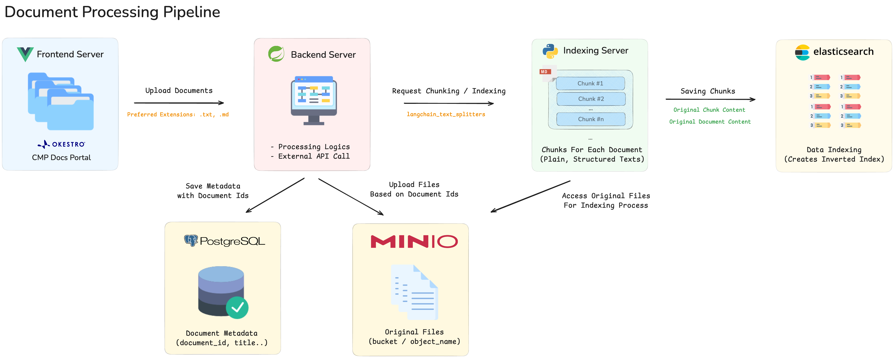
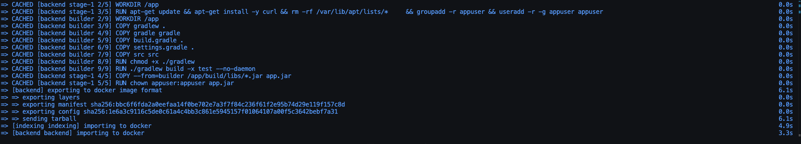
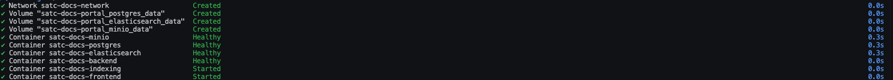
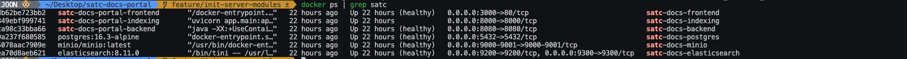

# 🤖 satc-docs-portal

## 📘 About
SATC(Standard for AI Tools Commando)에서 개발하는 MCP Server의 문서 데이터 기반을 관리하는 포탈입니다.  
참고 문서 최신화, 문서 관리 포인트 일원화를 통한 개발 생산성 제고 및 편의성 증대를 목표로 합니다.  
**[참고] 위 프로젝트는 Cursor IDE를 활용한 Vibe Coding 기반으로 개발하였습니다.**

---
## 🧰  Stacks & Dependencies
### Infrastructure
- Database: PostgreSQL 16.3
- Searching Engine: Elasticsearch 8.11.0
- Object Storage: MinIO RELEASE.2025-09-07T16-13-09Z
- Deployment: Docker

### Frontend Server
- Framework: Vue.js 3.3.4
- Build Tool: Vite 4.4.5
- UI Library: Element Plus 2.3.8
- HTTP Client: Axios 1.11.0
- Markdown Rendering: markdown-it 14.1.0
- Minio Client: MinIO 8.0.5

### Backend Server
- Framework: Spring Boot 3.5.5
- Java Version: 17
- Database: PostgreSQL (Spring Data JPA)
- MinIO Client: MinIO 8.5.17

### Indexing Server
- Framework: FastAPI 0.104.1
- Python Runtime: uvicorn 0.24.0
- Search Engine: Elasticsearch 8.11.0
- Minio Client Client: MinIO 7.2.0
- Text Processing: LangChain Text Splitters 0.0.1


## 🏗️  Pipeline Overview

<br/><br/>


## 🛠 Server Overview
| 순번 | Server |    Port    |                           역할                           |                                   비고                                    |
|:--:|:------:|:--------------:|:------------------------------------------------------:|:-----------------------------------------------------------------------:|
| 1  |  docs-front  |  3000  | 문서 관리 포탈 Frontend Server | |
| 2  |  docs-back  | 8080 | 문서 관리 Backend Server | |
| 3  |  docs-indexing  | 8000 | 문서 Indexing Server | |
| 4  |  elasticsearch  | 9200/9300   | Chunk 및 문서 적재, 검색 Engine |  |
| 5  |  minio   | 9000/9001 | 실제 문서 관리 Object Storage | [MinIO UI](http://localhost:9001), id: minioadmin / pw: minioadmin|
| 6  |  postgres  |  5432   | 문서 메타데이터 관리 DB | id: postgres / pw: postgres|

---
## 🚀  Getting Started
### Docker Compose(All-in One)
> Mac OS를 기준으로 설명합니다.  
> Docker Daemon이 실행되고 있는 상태를 전제로 합니다.  
> Container별 Port Custom은 **docker-compose.yml**에서 가능합니다.

<br/>

***Docker Compose를 활용한 전체 Image Build 및 Container 실행***  

- 이미지 빌드 및 컨테이너 실행 Command
```sh
docker compose up {service-name} -d  

[옵션]
{service-name}: 원하는 service만 올리고 싶은 경우  
-d: Background로 Container를 띄우는 설정
```  


- Container Running 단계  


- 실행 중인 Container 확인
  ```sh
    docker ps -a | grep satc
  ```
  - 아래 6개 Container가 정상 실행 중인 상태  
    

- [문서관리포탈](http://localhost:3000) 접속 확인

<br/>

***Docker Compose를 활용한 전체 Image Build 및 Container 삭제***  

- 컨테이너 중지 및 이미지 삭제 Command
```sh
docker compose down {service-name} -v --rmi all
  
[옵션]
{service-name}: 원하는 service만 내리고 싶은 경우
-v: 해당 Container의 volume도 같이 삭제하고 싶은 경우
--rmi all: 관련된 이미지도 전부 지우고 싶은 경우
```


---
## 🔐  인증과 계정
계정은 DB(`app_user`, `app_user_role`)에 있고 비밀번호는 bcrypt 해시(`{bcrypt}...`)로만 저장합니다.  
로그인(`POST /api/v1/auth/login`)은 HS256 JWT를 `token`으로, 유효 시간(초)을 `expiresIn`으로 돌려줍니다. 서버는 세션을 저장하지 않으므로 재기동해도 토큰이 유지되고, 로그아웃은 클라이언트가 토큰을 버리는 것으로 끝납니다.  
요청마다 토큰 서명·만료를 확인한 뒤 계정을 다시 읽으므로, 계정을 비활성화(`enabled=false`)하거나 역할을 바꾸면 기존 토큰에도 바로 반영됩니다.

인증 관련 환경변수(`DOCS_AUTH_*`)는 아래 환경변수 표에 있습니다.

개발용 계정은 `admin`, `editor`, `viewer`, `planner`, `backend`, `frontend`, `data`, `reviewer`이고 비밀번호는 `<이름>123`입니다. 운영에서는 켜지 마세요.

- 로컬 개발: `./gradlew bootRun --args='--spring.profiles.active=dev'` (임시 서명 키 + 개발용 계정)
- 운영(docker compose): `.env`에 `DOCS_AUTH_TOKEN_SECRET`, 처음 한 번 `DOCS_AUTH_ADMIN_USERNAME`/`DOCS_AUTH_ADMIN_PASSWORD`를 설정합니다. 서명 키는 저장소에 커밋하지 마세요.

### MCP 클라이언트 로그인 (OAuth)
백엔드는 MCP 클라이언트(Claude Code 등)를 위한 최소 OAuth 2.1 인가 서버이기도 합니다. 클라이언트가 브라우저를 열면 사용자는 평소 포털 계정으로 로그인하고 동의 화면(`/oauth/consent`)에서 허용합니다. 클라이언트는 포털 JWT를 받고, 유효 시간은 `DOCS_OAUTH_TOKEN_TTL`(기본 7일)입니다. 리프레시 토큰은 없어서 만료되면 브라우저 로그인을 다시 합니다.

| 엔드포인트 | 용도 |
|---|---|
| `GET /.well-known/oauth-authorization-server` | 인가 서버 메타데이터(RFC 8414) |
| `POST /oauth/register` | 공개 클라이언트 동적 등록(RFC 7591). redirect_uri는 http 루프백(`127.0.0.1`, `[::1]`, `localhost`)이나 `DOCS_OAUTH_ALLOWED_REDIRECT_URIS`만 |
| `GET /oauth/authorize` | 인가 요청 검증 뒤 동의 화면으로 이동. PKCE S256 필수, client_id·redirect_uri가 틀리면 리다이렉트하지 않고 400 |
| `GET /oauth/authorize/requests/{id}`, `POST .../approve`, `POST .../deny` | 동의 화면 전용. 승인은 로그인한 사용자의 포털 토큰(Authorization 헤더)으로 하며 60초짜리 1회용 코드를 만듭니다 |
| `POST /oauth/token` | `authorization_code` + `code_verifier` 교환. 코드는 한 번만 쓸 수 있습니다 |

등록 클라이언트는 `oauth_client` 테이블에, 동의 대기 요청(10분)과 코드(60초)는 백엔드 메모리에 둡니다. 백엔드를 여러 대 띄우면 코드 저장소를 공유해야 하므로 지금은 한 대 기준입니다.

---
## 📝  스펙 워크플로우와 실시간 알림
기능을 **PRD → 기술문서(BE/FE/DATA) → 구현 → 구현 승인** 순서로 포털에 올려 진행할 수 있습니다. 상태 전이는 서버가 판단하고 사람은 승인만 합니다. 문서 검색에서 PRD·기술문서도 함께 찾고, 문서나 스펙이 바뀌면 열려 있는 화면에 SSE로 알림이 갑니다.

| 문서 | 내용 |
|---|---|
| [docs/architecture.md](docs/architecture.md) | 구성요소, 업로드·인덱싱·검색·SSE 흐름, 상태 다이어그램(Mermaid) |
| [docs/spec-workflow.md](docs/spec-workflow.md) | 단계별 사용법, 단계마다 필요한 계정(역할), MCP 도구 순서, 계정 바꾸는 법, 자주 만나는 오류(403·409) |
| [docs/live-events.md](docs/live-events.md) | `GET /api/v1/events`(SSE) 계약, `X-Client-Id`, 프론트 동작 규칙, 문서 상태(`FAILED` 포함)와 문제 해결 |

코드를 고친 뒤에는 컨테이너를 다시 빌드해야 `localhost:8080`에 반영됩니다: `docker compose up -d --build backend indexing`

---
## ⚙️  환경변수
docker compose는 저장소 루트의 `.env`를 읽습니다. `cp .env.example .env`로 만들고 값을 채우세요. `.env`는 git에 올라가지 않습니다.  
아무 값도 없으면 compose와 로컬 개발은 아래 기본값(localhost)으로 동작합니다. 운영 필수 항목은 기본값이 운영에서 맞지 않으므로 반드시 설정합니다.

| 환경변수 | 계층 | 기본값 | 운영 필수 | 설명 |
|---|---|---|:-:|---|
| `SPRING_PROFILES_ACTIVE` | backend | 없음 (compose `satc`) | | `dev`면 임시 서명 키·개발용 계정·localhost CORS를 씁니다. 운영에서 쓰지 마세요 |
| `SPRING_DATASOURCE_URL` | backend | `jdbc:postgresql://127.0.0.1:5432/docs` (compose는 `postgres` 컨테이너) | O | PostgreSQL 주소 |
| `SPRING_DATASOURCE_USERNAME` / `SPRING_DATASOURCE_PASSWORD` | backend | `postgres` / `postgres` (compose는 `POSTGRES_USER`/`POSTGRES_PASSWORD`) | O | DB 계정 |
| `CORS_ALLOWED_ORIGINS` | backend | 없음 (`dev` 프로필 `http://localhost:3000,http://127.0.0.1:3000`, compose `http://localhost:3000`) | O | 브라우저 요청을 허용할 프론트엔드 Origin, 쉼표로 구분. 비어 있으면 기동하지 않습니다 |
| `MINIO_HOST` / `MINIO_PORT` | backend | `127.0.0.1` / `9000` (compose는 `minio` 컨테이너) | O | MinIO 주소 |
| `MINIO_CLIENT_ID` / `MINIO_CLIENT_SECRET` | backend | `minioadmin` / `minioadmin` (compose는 `MINIO_ACCESS_KEY`/`MINIO_SECRET_KEY`) | O | MinIO 계정 |
| `MINIO_BUCKET_NAME` | backend, indexing | `docs` | | 문서 버킷 |
| `EXTERNAL_API_HOST` / `EXTERNAL_API_PORT` | backend | `http://127.0.0.1` / `8000` (compose는 `indexing` 컨테이너) | O | indexing 서비스 주소. 업로드 알림을 보냅니다 |
| `EXTERNAL_API_ENABLED` | backend | `true` | | `false`면 indexing 알림을 보내지 않습니다 |
| `DOCS_SYNC_TOKEN` | backend | 없음 | | 코드→문서 동기화(`PUT /api/v1/docs/sync`) 토큰. 비어 있으면 동기화 API를 끕니다 |
| `DOCS_AUTH_TOKEN_SECRET` | backend | 없음 | O | 로그인 토큰 서명 키, 32바이트 이상. 비어 있으면 기동하지 않습니다(`dev` 프로필만 예외로 기동마다 임시 키 생성). 예: `openssl rand -base64 48` |
| `DOCS_AUTH_TOKEN_TTL` | backend | `12h` | | 토큰 유효 시간 |
| `DOCS_AUTH_ADMIN_USERNAME` / `DOCS_AUTH_ADMIN_PASSWORD` | backend | 없음 | 첫 기동 | 둘 다 설정하면 해당 username이 없을 때만 ADMIN 계정을 만듭니다. 이미 있으면 비밀번호를 바꾸지 않습니다 |
| `DOCS_AUTH_DEV_ACCOUNTS` | backend | `false` (`dev` 프로필은 `true`) | | 개발용 계정을 없을 때만 만듭니다 |
| `DOCS_OAUTH_ISSUER` | backend | 없음 (`dev` 프로필·compose `http://localhost:8080`) | O | OAuth issuer, MCP 클라이언트가 이 백엔드에 접근하는 공개 주소. 비어 있으면 기동하지 않습니다 |
| `DOCS_OAUTH_CONSENT_URL` | backend | 없음 (`dev` 프로필·compose `http://localhost:3000/oauth/consent`) | O | 프론트엔드 동의 화면 주소. 비어 있으면 기동하지 않습니다 |
| `DOCS_OAUTH_TOKEN_TTL` | backend | `168h` | | OAuth로 발급하는 토큰의 유효 시간 |
| `DOCS_OAUTH_ALLOWED_REDIRECT_URIS` | backend | 없음 | | 루프백 외에 등록을 허용할 redirect_uri, 쉼표 구분·정확히 일치 |
| `VITE_API_BASE_URL` | frontend | `http://localhost:8080` (compose 동일) | O | 브라우저가 호출할 백엔드 주소. 컨테이너는 기동 시 이 값으로 `/config.js`를 만들고, 비어 있으면 기동하지 않습니다. `npm run dev`/`build`는 Vite 환경변수로 읽습니다 |
| `VITE_JENKINS_URL` / `VITE_ARGOCD_URL` / `VITE_COMMON_CODE_URL` | frontend | 없음 | | 상단 바로가기 링크. 비어 있으면 해당 링크를 숨깁니다 |
| `POSTGRES_DB` / `POSTGRES_USER` / `POSTGRES_PASSWORD` | compose | `docs` / `postgres` / `postgres` | O | postgres 컨테이너 초기값이자 backend DB 계정 |
| `MINIO_ACCESS_KEY` / `MINIO_SECRET_KEY` | compose | `minioadmin` / `minioadmin` | O | minio 컨테이너 루트 계정이자 backend·indexing MinIO 계정 |
| `BACKEND_PORT` / `FRONTEND_PORT` / `INDEXING_PORT` / `POSTGRES_PORT` / `MINIO_PORT` / `MINIO_CONSOLE_PORT` | compose | `8080` / `3000` / `8000` / `5432` / `9000` / `9001` | | 호스트에 여는 포트 |

indexing 서비스의 나머지 설정(`ELASTICSEARCH_HOST`, `CHUNK_SIZE` 등)은 `indexing/app/config.py`와 `docker-compose.yml`을 보세요.

---
## 🌈  License
| 순번 | 사용 기술 |   버전   |           라이선스            |               용도               |  비고  |
|:--:|:----:|:--------:|:--------------------------:|:-------------------------------:|:----:|
| 1  | Elasticsearch | 8.11.0 | [Elastic License 2.0](https://www.elastic.co/kr/licensing/elastic-license) | 문서 Indexing 저장 및 Search Engine | [조직 내부적으로 사용 가능](https://www.elastic.co/kr/licensing/elastic-license/faq/) |
| 2  | PostgreSQL | 16.3 | [PostgreSQL License](https://www.postgresql.org/about/licence/) | 문서 메타데이터 관리 | BSD, MIT License와 유사 |
| 3  | MinIO | RELEASE.2025-09-07T16-13-09Z | [GNU AGPL v3](https://www.min.io/compliance#Licensing) | 실제 문서 데이터 관리 | [조직 내부적으로 사용 가능](https://www.gnu.org/licenses/gpl-faq.html#GPLRequireSourcePostedPublic) |

> 단, 위 License의 적용 범위는, 개인 및 사내 환경(내부)에서 사용하는 경우를 전제로 합니다.  
> 서비스를 공개적으로 배포하거나 외부 고객이 활용하는 경우, 라이센스 정책 위반·소스코드 공개 의무 발생 등의 문제가 발생할 수 있습니다. 

<br/>

## 📄 README Version Management
| 순번 |  작성일자  |   작성자   |           작성 내용            |               비고               |
|:--:|:----:|:--------:|:--------------------------:|:-------------------------------:|
| 1  | 25.09.10 | [신준](mailto:j.shin@example.com) | 개요, 기술, Getting Started, License 등 | 초안 |
| 2  | - | - | - | - |

