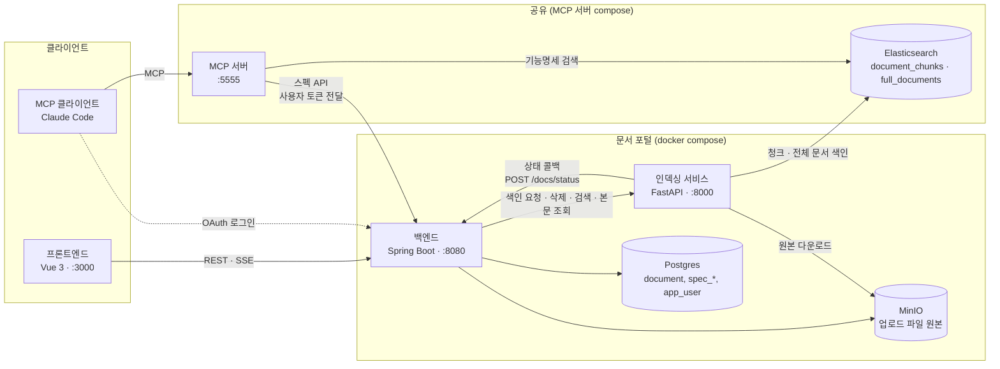
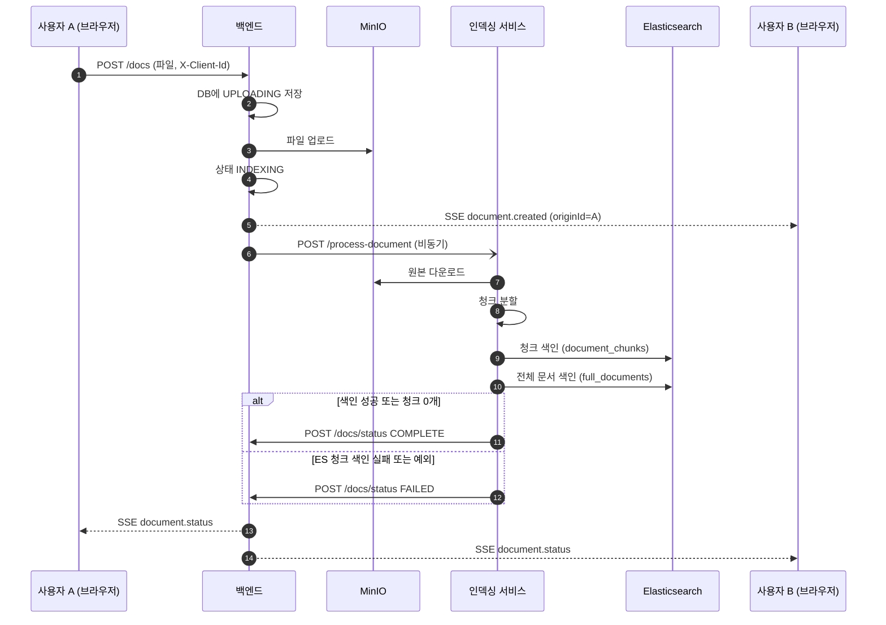
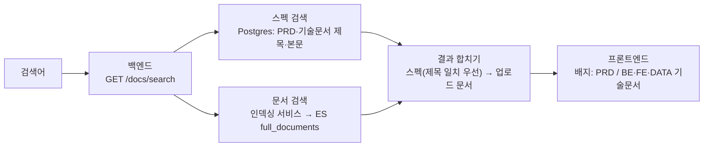
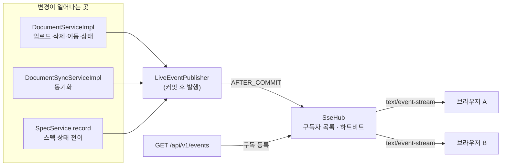
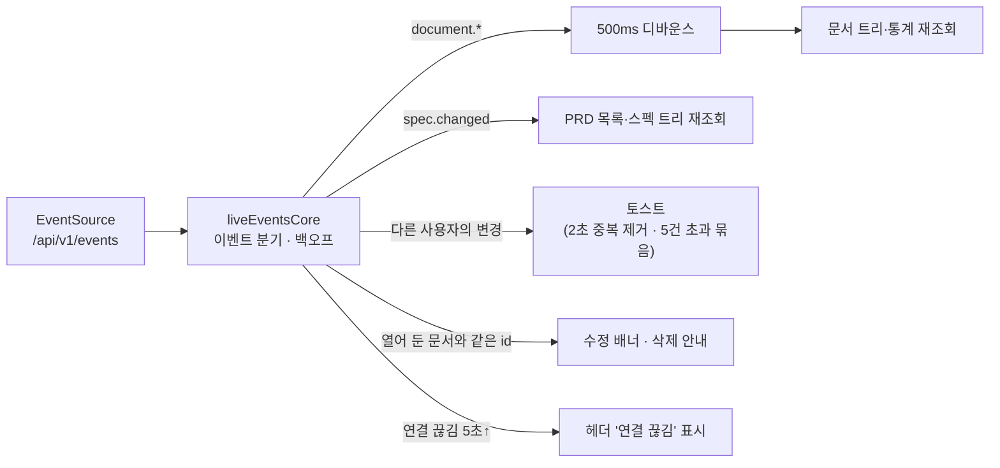
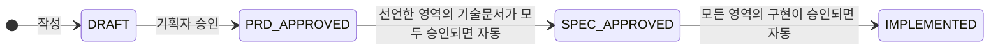
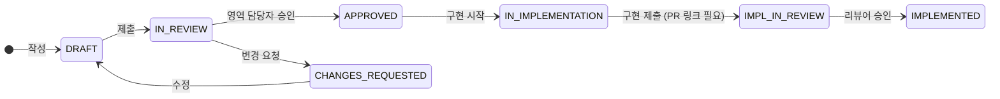
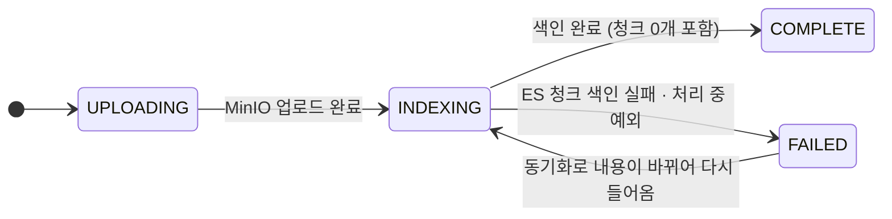

# 아키텍처

문서 포털이 어떤 구성요소로 이루어져 있고, 문서가 올라올 때·검색할 때·바뀔 때 데이터가 어떻게 흐르는지 설명합니다. 다이어그램은 Mermaid라서 GitHub와 Notion에서 그대로 렌더링됩니다. 모든 호출 관계는 코드에서 확인한 것입니다.

## 1. 구성요소

| 구성요소 | 역할 |
|---|---|
| 프론트엔드 | 문서 트리, 검색, PRD·기술문서 화면. 백엔드에 직접 연결하고 SSE로 변경 알림을 받습니다 |
| 백엔드 | 문서·스펙 API, 인증(JWT)과 MCP용 OAuth 서버, SSE 이벤트 허브, 스펙 워크플로우 전이 규칙 |
| 인덱싱 서비스 | MinIO의 문서를 청크로 쪼개 ES에 색인하고, 끝나면 백엔드에 상태를 알립니다. 전체 문서 검색도 담당 |
| Postgres | 문서 트리(`document`), PRD·기술문서(`spec_document`, `spec_event`, `spec_pr_link`), 계정, OAuth 클라이언트 |
| MinIO | 업로드한 문서 파일 원본 |
| Elasticsearch | 포털이 `document_chunks`(청크)와 `full_documents`(전체 문서)를 씁니다. MCP 서버도 같은 클러스터를 공유합니다 |
| MCP 서버 | Claude Code 등이 쓰는 도구 모음. 스펙 워크플로우 도구는 로그인한 사용자의 토큰으로 백엔드를 호출합니다 |

**데이터 정본**: 업로드 문서는 MinIO 파일이 원본이고 ES는 검색용 파생물입니다. PRD·기술문서는 Postgres의 마크다운이 정본이며 ES에는 색인하지 않습니다.

## 2. 문서 업로드와 인덱싱

- A가 올린 `document.created`는 `originId`가 A 자신이라 A 화면에는 토스트가 뜨지 않고 트리만 갱신됩니다. B 화면에는 토스트가 뜹니다.
- 상태 콜백은 서버 간 호출이라 `X-Client-Id`가 없어 `originId`가 비어 있고, 모든 화면이 받습니다.
- 인덱싱 서비스는 상태 갱신 응답의 본문 `status`도 확인합니다(백엔드가 HTTP 200에 본문 `status: 500`으로 실패를 알리는 경우가 있음).

## 3. 검색

- PRD·기술문서는 ES에 없으므로 Postgres에서 직접 찾습니다. 모든 검색어 단어가 제목 또는 본문에 있어야 하고, 새 버전이 있는 이전 PRD 버전은 제외합니다.
- 업로드 문서는 ES 제목을 쓰고, 포털 DB에 없는 색인 항목(`indexOnly`)은 `GET /docs/indexed/{id}`로 본문을 가져옵니다.
- 업로드 문서 본문은 `GET /docs/{id}/content`(MinIO)로 가져옵니다.

## 4. 실시간 이벤트 (SSE) 내부 구조

- 이벤트는 DB 커밋 뒤에 나갑니다. 트랜잭션 없이 저장되는 경로도 있어서 `fallbackExecution`으로 즉시 보냅니다.
- 허브는 서버 메모리에 있어 **백엔드가 한 인스턴스일 때만** 모든 화면에 전달됩니다.

프론트엔드 쪽 흐름:

## 5. 스펙 워크플로우 상태

PRD:

새 버전이 승인되면 이전 버전의 승인된 PRD는 시스템이 `SUPERSEDED`로 바꾸고 읽기 전용이 됩니다.

기술문서:

계정별 권한과 도구 호출 순서는 [spec-workflow.md](spec-workflow.md)를 보세요.

## 6. 문서 상태

