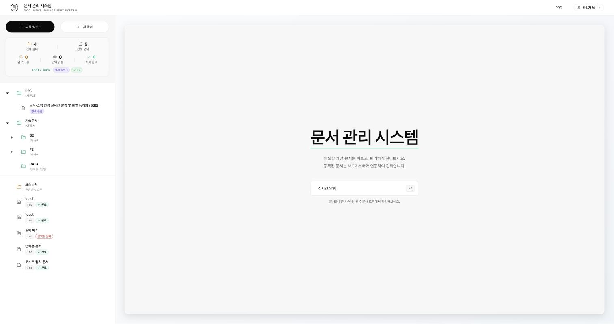

# 실시간 알림 (SSE) 사용법

문서나 PRD·기술문서가 바뀌면 포털이 열려 있는 모든 화면에 이벤트를 보내서, 새로고침 없이 문서 트리·PRD 목록·통계를 갱신하고 알림을 띄웁니다. 서버 전송 이벤트(SSE)를 씁니다.

전체 구조는 [architecture.md](architecture.md)의 "실시간 이벤트 (SSE) 내부 구조"를 보세요.

## 이벤트가 나가는 때

| 이벤트 `type` | 언제 | `actor` |
|---|---|---|
| `document.created` | 문서 업로드, 폴더 생성, 동기화로 새 문서 생성 | 없음 |
| `document.updated` | 동기화(`PUT /docs/sync`)로 본문이 바뀜 | 없음 |
| `document.status` | 문서 상태 변경(`UPLOADING` → `INDEXING` → `COMPLETE` / `FAILED`) | 없음 |
| `document.deleted` | 문서 삭제 | 없음 |
| `document.moved` | 문서 이동 | 없음 |
| `spec.changed` | PRD·기술문서 생성, 수정, 상태 전이 | 로그인 사용자명(시스템이 일으킨 전이는 `system`) |

업로드 문서 API(`/docs/**`)에는 인증이 없어서 문서 이벤트의 `actor`는 비어 있습니다. 스펙 이벤트만 사용자명이 있습니다.

## API

`GET /api/v1/events` (`text/event-stream`, 인증 없음)

```
curl -N http://localhost:8080/api/v1/events
```

```
event:hello
data:{"type":"hello","at":"2026-11-03T06:22:24.987Z"}

event:document.created
data:{"type":"document.created","id":"…","title":"문서 제목","parentId":null,"status":"INDEXING","actor":null,"originId":"tab-A","at":"…"}

: ping
```

- 연결 직후 `hello`를 한 번 보냅니다. 재연결했을 때 놓친 이벤트를 복구하는 기준으로 쓰세요. 서버는 이벤트를 보관하지 않습니다.
- 30초마다 `: ping` 주석을 보냅니다(연결 유지용, 이벤트 아님).
- 데이터 필드: `type, id, title, parentId, status, actor, originId, at`. **문서 본문은 절대 담지 않습니다.** 본문이 필요하면 이벤트를 받은 뒤 API로 다시 조회하세요.
- 동시 연결은 200개까지입니다(`docs.live.max-connections`). 초과하면 503입니다. 한 연결의 최대 유지 시간은 30분이고, 끊기면 클라이언트가 다시 연결합니다.
- 이벤트는 DB 커밋 뒤에 나갑니다. 롤백된 변경은 이벤트가 나가지 않습니다.

## 본인 변경 구분: `X-Client-Id`

변경 요청(업로드, 삭제 등)에 선택 헤더 `X-Client-Id: <탭마다 다른 임의 값>`을 붙이면, 그 요청이 만든 이벤트의 `originId`에 같은 값이 실립니다. 화면은 `originId`가 자기 값이면 토스트를 띄우지 않고 목록만 갱신합니다.

```
curl -X POST -H 'X-Client-Id: my-tab' -F "file=@a.md" http://localhost:8080/api/v1/docs
```

- 값은 128자까지만 쓰이고 비어 있으면 `originId`는 null입니다. 위조할 수 있으므로 보안 용도가 아니라 알림 생략용입니다.
- 인덱싱 서비스가 호출하는 상태 갱신(`document.status`)은 헤더가 없어 `originId`가 null이고 모든 클라이언트에 알림이 갑니다.

## 프론트엔드

| 위치 | 하는 일 |
|---|---|
| `src/composables/useLiveEvents.js` | 로그인 후 `Home.vue`에서 시작해 `EventSource`를 열고, 로그아웃이나 화면을 떠나면 닫습니다 |
| `src/composables/liveEventsCore.js` | Vue와 무관한 순수 로직(백오프, 이벤트 분기, 토스트 합치기). 테스트는 `npm test` |
| `src/api/clientId.js` | 탭별 `clientId`를 만들어 `sessionStorage`에 보관하고 요청 인터셉터(`api/index.js`, `api/specs.js`)가 `X-Client-Id`로 붙입니다 |

동작 규칙:

다른 사용자가 문서를 올리면 이렇게 토스트가 뜨고, 문서 트리와 통계가 새로고침 없이 갱신됩니다.


- `document.*` 이벤트: 문서 트리와 통계를 다시 읽습니다. 연속 이벤트는 500ms로 묶습니다(`documents-changed` 창 이벤트).
- `spec.changed`: 기존 `specs-changed` 창 이벤트로 PRD 목록·스펙 트리를 다시 읽습니다.
- 토스트: 다른 사용자의 변경만 띄웁니다. 같은 문서·종류는 2초 안에 한 번만, 한꺼번에 5건을 넘으면 "N건의 변경이 있었습니다"로 묶습니다. `document.status`는 업로드 중 알림이 쏟아지지 않도록 토스트 없이 갱신만 합니다.
- 보고 있는 문서가 수정되면 본문을 바꾸지 않고 "문서가 수정되었습니다. 새로고침" 배너를 띄웁니다. 삭제되면 안내를 띄우고 선택을 해제합니다.
- 연결이 5초 넘게 끊기면 헤더에 "실시간 연결 끊김, 재연결 중"이 표시됩니다. 재연결은 1, 2, 4초…최대 30초 간격이며, 연결되면 목록을 한 번 다시 읽습니다. 서버가 503이면 30초 뒤에 다시 시도합니다.
- 개발 서버(`:3000`)에서 백엔드(`:8080`)로 직접 연결하므로 백엔드의 CORS 허용 Origin에 `:3000`이 있어야 합니다(`CORS_ALLOWED_ORIGINS`).

## 문서 상태와 인덱싱 실패

업로드한 문서는 `UPLOADING` → `INDEXING` → `COMPLETE` 순으로 바뀌고, 인덱싱에 실패하면 `FAILED`가 됩니다(문서 트리에 "인덱싱 실패"로 표시, 관리자에게만 보임).

ES 청크 색인이 실패한 문서는 관리자의 문서 트리에 빨간 "인덱싱 실패" 태그로 표시됩니다(아래 화면의 `실패 예시`).



- 제목(`#`)이 없거나 너무 짧아 청크가 0개인 문서도 전체 문서는 색인되어 검색되고 `COMPLETE`가 됩니다.
- ES 청크 색인이 모두 실패하거나 처리 중 예외가 나면 `FAILED`가 됩니다. 파일은 저장소에 있어서 문서는 열 수 있지만 검색에는 안 잡힐 수 있습니다. 동기화(`PUT /docs/sync`)로 내용이 바뀌어 다시 들어오면 `INDEXING`부터 다시 시작합니다. 같은 내용이면 상태가 그대로이고, 파일을 새로 올리면 새 문서가 만들어집니다.
- 인덱싱 서비스는 상태 갱신 응답의 본문 `status`도 확인합니다. 백엔드가 실패를 HTTP 200에 본문 `status: 500`으로 알리는 경우가 있기 때문입니다.
- `FAILED`를 처음 도입할 때 Postgres의 enum CHECK 제약이 옛 값만 허용해서 저장이 실패했습니다. 백엔드가 기동할 때 `document` 테이블의 이 제약을 지웁니다(`SpecSchemaUpgrade`). 기존 DB는 백엔드를 한 번 재기동하면 반영됩니다.

## 문제 해결

| 증상 | 확인 |
|---|---|
| 알림이 안 옴 | `curl -N http://localhost:8080/api/v1/events`에서 `hello`가 오는지. 안 오면 백엔드가 이전 이미지일 수 있으니 `docker compose up -d --build backend` |
| 다른 탭에서 변경해도 갱신이 안 됨 | 브라우저 개발자 도구의 Network에서 `events` 요청이 `eventsource`로 열려 있는지. CORS 오류면 `CORS_ALLOWED_ORIGINS` 확인 |
| 문서가 계속 `INDEXING` | `docker logs satc-docs-indexing`에서 해당 문서 id 로그를 확인. `Status update rejected by backend`가 보이면 백엔드 로그를 확인 |
| 문서 트리에서 폴더가 접힘 | 알려진 한계. 다른 사용자의 변경 때 트리를 루트부터 다시 읽기 때문입니다 |
| 백엔드를 여러 대로 늘렸더니 일부만 알림을 받음 | 이벤트 허브가 서버 메모리에 있어서 한 인스턴스에서만 전달됩니다. 여러 대로 늘리려면 Redis pub/sub 같은 공유 수단이 필요합니다 |
