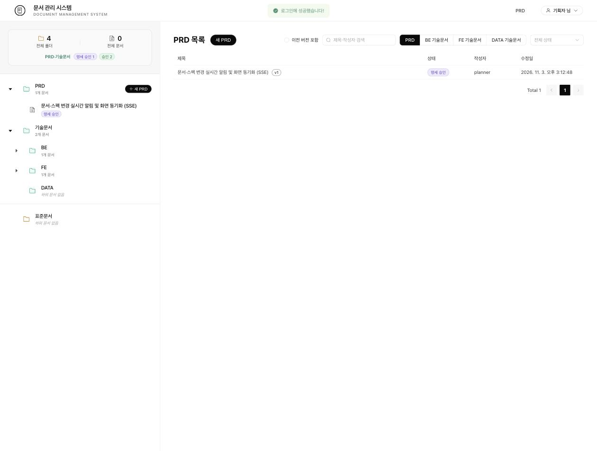
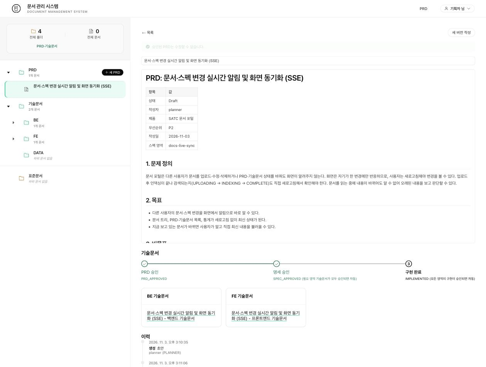
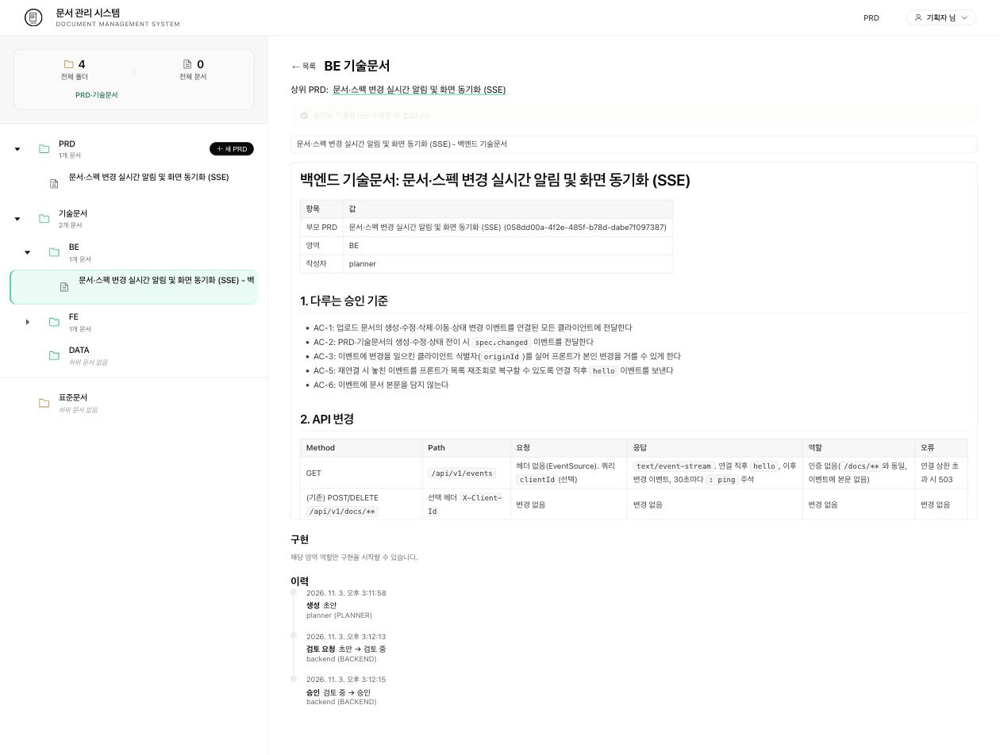
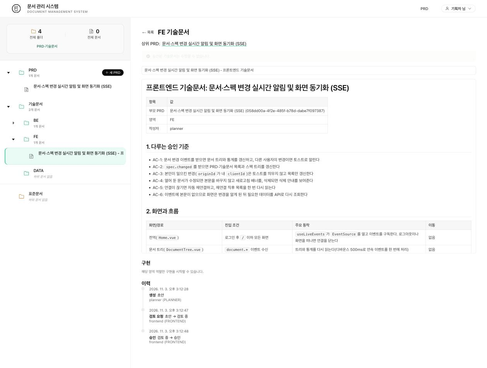

# 스펙 워크플로우 사용법

기능 하나를 **PRD → 기술문서(BE/FE/DATA) → 구현 → 구현 승인** 순서로 포털에 올려서 진행하는 방법입니다. 상태 전이는 서버가 판단하고, 사람은 승인만 합니다. 도구 목록과 설계 배경은 [`satc-mcp-server/README.md`](../../satc-mcp-server/README.md)의 "스펙 워크플로우" 절을 보세요.

이 방식으로 한 실제 사례(문서·스펙 변경 실시간 알림)는 [live-events.md](live-events.md)와 같은 작업이고, 시스템 전체 구조와 상태 흐름 그림은 [architecture.md](architecture.md)에 있습니다.

## 상태 흐름

| 문서 | 상태 흐름 |
|---|---|
| PRD | `DRAFT` → `PRD_APPROVED` → `SPEC_APPROVED` → `IMPLEMENTED` (새 버전이 승인되면 이전 버전은 `SUPERSEDED`) |
| 기술문서 | `DRAFT` → `IN_REVIEW` → `APPROVED`(또는 `CHANGES_REQUESTED`) → `IN_IMPLEMENTATION` → `IMPL_IN_REVIEW` → `IMPLEMENTED` |

- 선언한 영역의 기술문서가 **모두 승인되면** PRD가 자동으로 `SPEC_APPROVED`가 됩니다. 모든 영역의 구현이 승인되면 `IMPLEMENTED`가 됩니다.
- 포털 PRD 상세 화면 아래의 진행 표시줄(PRD 승인 → 명세 승인 → 구현 완료)로 현재 단계를 볼 수 있습니다.

## 누가 무엇을 하나

계정마다 역할이 다르고, 역할이 없는 작업은 403으로 거절됩니다. 개발용 계정과 비밀번호는 [README의 인증과 계정](../README.md#-인증과-계정)을 보세요.

| 단계 | 하는 일 | 계정(역할) |
|---|---|---|
| 1 | PRD 작성, 수정, 승인(`approve_prd`) | `planner` (PLANNER) |
| 2 | 필요한 영역 선언(`set_tech_areas`) | `planner` |
| 3 | 영역별 기술문서 작성, 제출(`submit_tech_doc`) | `planner` 또는 해당 영역 계정(`backend`=BE, `frontend`=FE, `data`=DATA) |
| 4 | 기술문서 승인 또는 변경 요청 | 해당 영역 계정 |
| 5 | 구현 시작(`start_implementation`), PR 연결(`link_pr`), 구현 제출(`submit_implementation`) | 해당 영역 계정 |
| 6 | 구현 승인 또는 변경 요청 | `reviewer` (REVIEWER) |

## 진행 순서 (MCP, Claude Code 기준)

1. **PRD 작성**: `get_prd_template`로 양식을 받아 모든 섹션을 채우고 `create_prd`로 저장합니다. 승인 기준은 `### AC-번호: 이름` 아래에 `(SHALL)` 또는 `(MUST NOT)` 문장과 `#### 시나리오:`로 씁니다. 형식이 틀리면 나중에 `export_prd_openspec`이 422를 돌려줍니다. 비어 있는 섹션을 추측으로 채우지 말고 기획자에게 물어보세요.
2. **PRD 승인**: 사람이 내용을 확인한 뒤 `approve_prd`를 호출합니다. AI가 임의로 승인하지 않습니다.
3. **영역 선언**: `set_tech_areas`로 필요한 영역만 선언합니다(예: 스키마·색인 변경이 없으면 DATA 제외). 선언하지 않은 영역의 `create_tech_doc`은 거부됩니다.
4. **기술문서 작성**: 영역마다 `get_tech_template` → `get_spec`(승인된 PRD 읽기) → `create_tech_doc` → 필요하면 `update_spec` → `submit_tech_doc`. 8절 "작업"은 구현 순서대로 체크박스 한 줄에 작업 하나와 `(검증: ...)`을 씁니다.
5. **기술문서 승인**: 영역 담당 계정이 `approve_tech_doc` 또는 `request_tech_doc_changes`. 변경 요청이면 `get_spec` 이력의 코멘트를 반영해 `update_spec` 후 다시 제출합니다.
6. **구현**: 영역 계정으로 `start_implementation` → 코드 작성 → PR 생성 → `link_pr` → `submit_implementation`. 잘못 붙인 링크는 구현 중에만 `unlink_pr`로 뗄 수 있습니다.
7. **구현 승인**: `reviewer` 계정이 `approve_implementation`. 모든 영역이 승인되면 PRD가 `IMPLEMENTED`가 됩니다.
8. **승인된 PRD를 바꿔야 할 때**: `create_prd_version` → `update_prd` → 기획자 승인. 구현 전 기술문서는 재검토(`IN_REVIEW`)로 돌아가고, 구현 단계 문서는 `prdChanged` 표시를 받습니다. 담당자가 영향을 확인한 뒤 `acknowledge_prd_change`를 호출합니다.

문서 id와 상태는 `list_specs`, `list_tech_docs`, `get_spec`으로 확인합니다.

## 계정 바꾸기

MCP는 **로그인한 사용자의 권한**으로 동작합니다. 역할이 다른 단계로 넘어가면 계정을 바꿔야 합니다.

1. Claude Code에서 `/mcp`를 실행하고 `satc`를 다시 인증합니다.
2. 브라우저가 열리면 필요한 계정(예: `backend`)으로 포털에 로그인하고 동의 화면에서 허용합니다.
3. 다시 `get_spec`이나 `list_specs`로 상태를 확인하고 이어서 진행합니다.

한 세션에서 계정이 바뀐 것을 확인하려면 `get_spec`의 `events`에서 `actor`와 `actorRole`을 보세요. 이력에 실제로 누가 했는지가 남습니다.

## 자주 만나는 문제

| 증상 | 원인 | 해결 |
|---|---|---|
| `이 작업을 수행할 역할이 없습니다: START_IMPLEMENTATION` (403) | 지금 계정에 그 단계의 역할이 없음 | 위 표의 계정으로 `/mcp` 재인증 |
| `submit_implementation`이 409 | 연결된 PR이 없음 | 먼저 `link_pr`. 링크는 사람이 가리킨 근거일 뿐이라 서버가 GitHub에서 확인하지는 않지만, 실제 PR이어야 합니다 |
| `create_tech_doc`이 409 | 선언하지 않은 영역 또는 PRD가 `PRD_APPROVED`가 아님 | `set_tech_areas`로 영역을 먼저 선언 |
| 검토 중이거나 승인된 문서를 수정하려 하면 409 | 기술문서는 `DRAFT`나 `CHANGES_REQUESTED`일 때만, PRD는 `DRAFT`일 때만 수정할 수 있음 | 승인된 PRD는 `create_prd_version`으로 새 버전을 만들고, 검토 중인 기술문서는 담당자가 변경 요청을 한 뒤 수정 |
| 기술문서 8절 체크박스가 내보내기에서 이상함 | 번호를 직접 썼음 | 번호는 쓰지 않습니다. 내보내기가 영역 순서대로 매깁니다 |

## 포털 화면에서 보기

아래는 실제 화면입니다(실시간 알림 작업의 PRD와 기술문서).

**PRD 목록** (`/specs`)



**PRD 상세** (`/specs/{id}`): 하단 진행 표시줄이 PRD 승인 → 명세 승인 → 구현 완료 단계를 보여주고, 딸린 기술문서와 이력이 이어집니다.



**BE 기술문서** (`/tech-docs/{id}`): 상위 PRD 링크, 본문, 구현 단계 조작, 이력(작성 → 검토 요청 → 승인과 계정).



**FE 기술문서**



화면별 경로:

- `/specs`: PRD 목록. 상단 탭으로 BE/FE/DATA 기술문서 목록으로 바꿀 수 있고 "이전 버전 포함"으로 `SUPERSEDED` PRD도 봅니다.
- `/specs/{id}`: PRD 상세와 하단 진행 표시줄, 딸린 기술문서, 이력.
- `/tech-docs/{id}`: 기술문서 상세, 구현 단계 조작, PR 링크, 이력.
- 문서 검색창에서 PRD·기술문서도 함께 검색됩니다. 결과에 "PRD", "BE 기술문서" 같은 배지가 붙고 누르면 해당 화면으로 이동합니다.

## 개발자용 확인 명령

변경을 만들었으면 PR 전에 아래를 확인하세요.

```
# 백엔드
cd backend && ./gradlew test --offline

# 프론트엔드
cd frontend && npm test && npx vite build

# 인덱싱 서비스 (의존 패키지가 이미지에 있으므로 컨테이너 이미지로 실행)
cd indexing && docker run --rm -v "$PWD":/work -w /work satc-docs-portal-indexing \
  python -m unittest tests.test_no_chunks_status
```

**코드를 고친 뒤에는 컨테이너를 다시 빌드해야 반영됩니다.** `localhost:8080`은 빌드된 이미지의 컨테이너입니다.

```
docker compose up -d --build backend indexing
```
